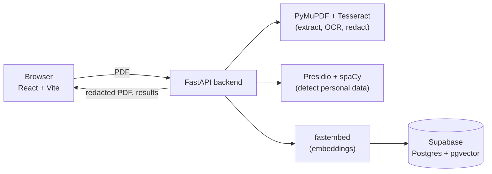

# RedactLens

> Black out personal data before a document goes public.


**Live demo:** [RedactLens](https://redactlens.netlify.app)

RedactLens helps public bodies, researchers and journalists prepare documents for release, for example in response to Freedom of Information (FOI) requests. You upload a PDF, digital or scanned. RedactLens finds personal data, you review every detection, and it exports a copy in which that text is permanently removed. Reviewed documents can be added to a private, searchable library that finds passages by meaning rather than exact words.

> **Demo only.** Use fake or public documents. Do not upload real personal data to a public deployment.

<!--
Screenshots: add images to docs/screenshots/ and uncomment.


-->

## Why this exists

Public bodies hold decades of records as scanned paper and PDFs. Two problems follow:

1. **Finding things is slow.** FOI requests mean digging through archives by hand.
2. **Releasing things is risky.** Personal data (names, addresses, ID numbers) must be removed before release. Missing one is a privacy breach, so agencies over-redact or delay.

RedactLens speeds up the tedious part (finding and removing personal data) and keeps a human in charge of every decision.

## Features

- **PDF upload** with text extraction. Scanned pages are read with OCR (Tesseract).
- **Personal data detection** for names, places, emails and phone numbers, plus Irish formats: PPS numbers, Irish mobile numbers and Eircodes.
- **Human review.** Every detected item can be kept or redacted, either from a checklist or by clicking it in the document. A live preview shows exactly what the export will look like.
- **True redaction.** Text in digital PDFs is deleted from the file, not just covered. Scanned pages have black boxes burned into the image and the original page is discarded. Hidden metadata is cleared.
- **Fails loudly.** If an approved item cannot be found in the PDF, the app tells you instead of silently leaving it in.
- **Private semantic search.** Only the _redacted_ text is embedded and stored, and the library is tied to your browser session with a one-click delete.
- **Uncertainty is visible.** Single-word guesses from the language model are outlined so reviewers know where to look twice.

## How it works

1. **Extract.** PyMuPDF reads each page's text layer. Pages without real text are rendered to an image and run through Tesseract OCR.
2. **Detect.** Microsoft Presidio, backed by a small spaCy model and custom Irish patterns, finds personal data and returns each item's type, position and confidence.
3. **Review.** The React interface highlights detections. The reviewer decides what to redact.
4. **Redact.** For digital pages, PyMuPDF finds each approved item and applies true redactions. For scanned pages, OCR word positions locate each item and black boxes are painted into the pixels.
5. **Index (optional).** Approved items are replaced with `[REDACTED]`, the text is split into passages, embedded with fastembed, and stored in Supabase (Postgres + pgvector).
6. **Search.** A question is embedded and matched against stored passages by cosine similarity.



## Tech stack

| Layer                   | Technology                                                                      |
| ----------------------- | ------------------------------------------------------------------------------- |
| Frontend                | React, Vite, plain CSS (Bricolage Grotesque and IBM Plex Mono fonts)            |
| Backend                 | Python, FastAPI, Uvicorn                                                        |
| PDF handling            | PyMuPDF, Pillow                                                                 |
| OCR                     | Tesseract via pytesseract                                                       |
| Personal data detection | Microsoft Presidio Analyzer, spaCy (`en_core_web_sm`), custom regex recognizers |
| Embeddings              | fastembed with `BAAI/bge-small-en-v1.5` (384 dimensions)                        |
| Database                | Supabase (Postgres, pgvector, row level security)                               |
| Hosting                 | Netlify (frontend), Render with Docker (backend)                                |

Everything used here has a free tier or is open source.

## Project structure

```
RedactLens/
├── frontend/
│   ├── public/
│   │   └── sample-letter.pdf      Synthetic sample for the demo button
│   ├── src/
│   │   ├── components/
│   │   │   ├── Header.jsx
│   │   │   ├── Landing.jsx
│   │   │   ├── Workspace.jsx      Document view and review panel
│   │   │   └── SearchView.jsx
│   │   ├── api.js                 Calls to the backend
│   │   ├── entities.js            Labels and colours for data types
│   │   ├── App.jsx
│   │   ├── main.jsx
│   │   └── index.css              Design tokens and styles
│   └── package.json
├── backend/
│   ├── main.py                    API app, /extract and /redact
│   ├── ocr.py                     Text extraction with OCR fallback
│   ├── pii.py                     Personal data detection
│   ├── scan_redact.py             Redaction of scanned pages
│   ├── search.py                  /index, /search, /library
│   ├── embeddings.py              fastembed wrapper
│   ├── db.py                      Supabase client
│   ├── Dockerfile
│   ├── requirements.txt
│   └── .env.example
├── .gitignore
├── LICENSE
└── README.md
```

## Getting started

### Prerequisites

- Node.js 20 or newer
- Python 3.12 or newer
- [Tesseract OCR](https://github.com/tesseract-ocr/tesseract): Windows users can use the UB Mannheim installer, macOS `brew install tesseract`, Debian/Ubuntu `sudo apt install tesseract-ocr`
- A free [Supabase](https://supabase.com) project (only needed for the search library)

### 1. Clone

```bash
git clone https://github.com/SCORLEOs773/RedactLens.git
cd RedactLens
```

### 2. Backend

```bash
cd backend
python -m venv venv

# Windows PowerShell
venv\Scripts\Activate.ps1
# macOS / Linux
source venv/bin/activate

pip install -r requirements.txt
python -m spacy download en_core_web_sm
```

Copy `.env.example` to `.env` and fill it in:

| Variable          | Purpose                                                                                    |
| ----------------- | ------------------------------------------------------------------------------------------ |
| `SUPABASE_URL`    | Your Supabase project URL                                                                  |
| `SUPABASE_KEY`    | Your Supabase **secret** key. Server only, never commit it                                 |
| `TESSERACT_CMD`   | Path to `tesseract.exe`, only if it is not on your PATH (common on Windows)                |
| `ALLOWED_ORIGINS` | Comma-separated frontend URLs allowed to call the API. Defaults to `http://localhost:5173` |

Run the API:

```bash
uvicorn main:app --reload
```

Check `http://localhost:8000/health`. Interactive API docs are at `http://localhost:8000/docs`.

### 3. Database (for the search library)

Open the Supabase **SQL Editor** and run:

<details>
<summary>Show SQL</summary>

```sql
create extension if not exists vector;

create table documents (
  id uuid primary key default gen_random_uuid(),
  session_id text not null,
  filename text not null,
  created_at timestamptz default now()
);

create table chunks (
  id bigserial primary key,
  document_id uuid references documents(id) on delete cascade,
  session_id text not null,
  page int not null,
  content text not null,
  embedding vector(384) not null
);

create index on chunks (session_id);
create index on chunks using hnsw (embedding vector_cosine_ops);

-- Only the backend (with the secret key) can read or write
alter table documents enable row level security;
alter table chunks enable row level security;

create or replace function match_chunks(
  query_embedding vector(384),
  match_session text,
  match_count int default 5
)
returns table (
  id bigint,
  document_id uuid,
  filename text,
  page int,
  content text,
  similarity float
)
language sql stable
as $$
  select c.id, c.document_id, d.filename, c.page, c.content,
         1 - (c.embedding <=> query_embedding) as similarity
  from chunks c
  join documents d on d.id = c.document_id
  where c.session_id = match_session
  order by c.embedding <=> query_embedding
  limit match_count;
$$;
```

</details>

### 4. Frontend

```bash
cd frontend
npm install
```

Create `frontend/.env`:

```
VITE_API_URL=http://localhost:8000
```

```bash
npm run dev
```

Open the URL Vite prints (usually `http://localhost:5173`).

## API

| Method | Endpoint   | Description                                                               |
| ------ | ---------- | ------------------------------------------------------------------------- |
| GET    | `/health`  | Liveness check                                                            |
| POST   | `/extract` | Upload a PDF. Returns per-page text, extraction method and detected items |
| POST   | `/redact`  | Upload a PDF and the approved items. Returns the redacted PDF             |
| POST   | `/index`   | Add a document's _redacted_ text to the session's search library          |
| POST   | `/search`  | Semantic search within the session's library                              |
| GET    | `/library` | List the session's documents                                              |
| DELETE | `/library` | Delete everything in the session's library                                |

## Privacy and security design

- **Real redaction, not overlays.** PyMuPDF's `apply_redactions` removes the text beneath each box. Scanned pages are flattened so the black is part of the pixels, and the original page is purged from the file.
- **Metadata is stripped** from exported PDFs.
- **Only redacted text is stored.** Approved items become `[REDACTED]` before chunking and embedding, so removed data never reaches the database.
- **Session-scoped library.** Each browser gets a random session ID and can only query its own documents. A "delete all" button removes them.
- **Locked-down database.** Row level security is on. Only the backend, holding the Supabase secret key, can access the tables. The key is never sent to the browser.
- **Upload limits.** 10 MB per file, 10 documents per session, capped passages per document.
- **Files are processed in memory** and not written to disk.

## Known limitations

RedactLens assists a human reviewer. It does not replace one, and it is not a compliance certification.

- Detection uses a small language model, so it can miss items and flag false positives (for example, product names). Single-word guesses are outlined for extra attention.
- Scanned-page redaction depends on OCR accuracy. If OCR misreads a name, it will not be detected.
- Handwriting is not supported.
- Text inside images embedded in _digital_ pages is not detected.
- English only. Irish formats (PPS number, mobile numbers, Eircode) are built in.
- On free hosting tiers, the backend sleeps when idle, so the first request can take a minute.

## Deployment

- **Backend:** Render web service using the Docker image in `backend/` (the image installs Tesseract and pre-downloads the models). Set `SUPABASE_URL`, `SUPABASE_KEY` and `ALLOWED_ORIGINS`.
- **Frontend:** Netlify with base directory `frontend`, build command `npm run build`, and the environment variable `VITE_API_URL` set to the backend URL.

## Roadmap

- [x] PDF upload, text extraction and OCR fallback
- [x] Personal data detection with Irish formats
- [x] Review interface with live redaction preview
- [x] True redaction for digital and scanned PDFs
- [x] Private semantic search over redacted documents
- [ ] LLM second opinion on uncertain detections
- [ ] Compliance flags (retention periods, special-category data)
- [ ] Batch processing and an audit log of decisions
- [ ] Handwriting support
- [ ] Dark theme and rate limiting

## License

MIT. See [LICENSE](LICENSE).

## Acknowledgements

[Microsoft Presidio](https://github.com/microsoft/presidio), [spaCy](https://spacy.io), [Tesseract](https://github.com/tesseract-ocr/tesseract), [PyMuPDF](https://pymupdf.readthedocs.io), [fastembed](https://github.com/qdrant/fastembed), [Supabase](https://supabase.com) and [FastAPI](https://fastapi.tiangolo.com).
